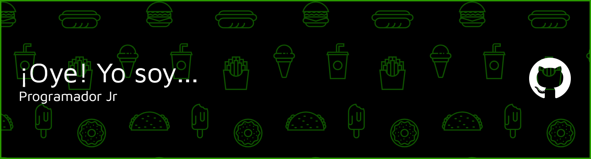

#  Bienvenido al Github de Luis Antonio

## 🧠 Actualmente estoy aprendiendo JavaScript

Me apasiona el desarrollo de software, la resolución de problemas y el aprendizaje continuo. Actualmente estoy profundizando en JavaScript mientras desarrollo proyectos con Python, Git y tecnologías web.

### 💻 Lenguajes

  
  
  
  
  

  
  
  

  

### 🌐 Desarrollo Web

  
  

  
 

  

  

  

### 🛠️ Herramientas

  

  

  

  

  <a href="https://www.gnu.org/software/bash/">
     <a href="https://www.github.com/l" target="_blank" rel="noreferrer"> <foto> <source media="(prefers-color-scheme: dark)" srcset="https://raw.githubusercontent.com/danielcranney/readme-generator/main/public/icons/socials/github-dark.svg" /> <source media="(prefers-color-scheme: light)" srcset="https://raw.githubusercontent.com/danielcranney/readme-generator/main/public/icons/socials/github.svg" />  </imagen> </a> 

## Insignias

<b>My GitHub Stats</b>

